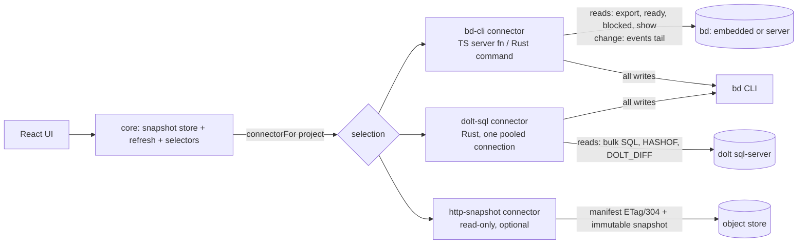

# Read layer: one core, pluggable connectors

Status: proposal (spike). Tracked by epic `bdb-84h` in the project's beads tracker. Full measurement grid: [reports/read-layer-poc.md](reports/read-layer-poc.md).

## Problem

Switching beads and loading comments is slow, most of all in the desktop app.

Evidence, desktop RUM over two days:

- `bd.call.*` p50 is 1 to 1.4 s and p95 is 4 to 6 s.
- INP on the bead modal is 2.8 to 3.6 s, with 0 long tasks and 0 errors.
- In a window that includes one bead-modal view, RUM records about 11 `projects`, 5 `list` and 3.5 `export` calls, against about 2 `show`.

Evidence from the code, verified by reading the source on the spike branch:

| Finding                                                                                                                                                                                                                   | Where                                                                                                  |
| ------------------------------------------------------------------------------------------------------------------------------------------------------------------------------------------------------------------------- | ------------------------------------------------------------------------------------------------------ |
| Every Tauri command is a sync `fn`. Tauri runs sync commands on the main thread, so each `bd` spawn (`Command::output()`) freezes the UI, and calls queue behind each other.                                              | `src-tauri/src/desktop.rs` (no `async` in the crate)                                                   |
| The Rust `get_bead_detail` runs `bd show`, then `bd comments`, one after the other. TypeScript runs them in parallel.                                                                                                     | `desktop.rs` `get_bead_detail_inner`, `src/lib/bd.ts` `getBeadDetail`                                  |
| `comment_count` is parsed but never used to skip `bd comments`.                                                                                                                                                           | both backends                                                                                          |
| `KnowledgeDetailModal` is always mounted and observes `['project-knowledge', p]` (a full `bd export`) with no `enabled` flag. Every feed change and every comment therefore re-runs `bd export`, even with no modal open. | `src/components/knowledge-detail-modal.tsx`                                                            |
| The same key has four observers, with staleTime 4 s, 4 s, 30 s and 60 s. The bead modal's copy (4 s) refetches on almost every switch.                                                                                    | `bead-detail-modal.tsx`, `routes/p.$project.tsx`, `project-knowledge-panel.tsx`, `use-palette-data.ts` |
| `['projects']` has three observers on the board page, each with its own 15 s interval. One `projects` call costs 3 to 4 `bd` processes per registered project, run serially.                                              | `project-topbar.tsx`, `project-rail.tsx`, `routes/p.$project.tsx`                                      |
| Every feed change invalidates `beads`, `project-knowledge` and `artifact`, plus one `bead` key per changed issue (300 ms debounce).                                                                                       | `src/hooks/use-bead-feed.ts`                                                                           |

Opening the modal by itself fires only `show`, `comment-author` and possibly `export`. The `projects` and `list` counts come from background polling and the always-mounted export observer, not from the click. A RUM trace that labels the call source is still needed to split the observed counts exactly (see Telemetry).

## Measurements

These are proof-of-concept measurements on a copy of a real tracker: 234 beads, 719 comments, 350 dependencies and 519 labels. The tools were bd 1.3.2 and Dolt 2.5.1 on an Apple-silicon laptop. Times are medians over 7 to 31 runs after a warm-up.

### Embedded `bd` versus a Dolt sql-server

| Operation                          | Embedded `bd`         | `bd` in server mode                                               | Raw SQL, one open connection                                                             |
| ---------------------------------- | --------------------- | ----------------------------------------------------------------- | ---------------------------------------------------------------------------------------- |
| `list --all --json`                | 430 ms                | 89 ms                                                             | issues + comments + deps (3 queries): 6.4 ms; 6.9 ms with labels; readiness not included |
| `ready` / `blocked`                | 239 / 150 ms          | 83 / 86 ms                                                        |                                                                                          |
| `export` (all beads with comments) | 414 ms                | 95 ms                                                             | (same 6.4 ms)                                                                            |
| `show <id>`                        | ~400 ms               | 72 ms                                                             | one bead, 4 queries: 1 ms                                                                |
| `comments <id>`                    | ~205 ms               | 70 ms                                                             |                                                                                          |
| Change probe                       | `bd vc status` 229 ms | 84 ms                                                             | `HASHOF('HEAD')`: 0.1 ms                                                                 |
| Delta since a commit               | none                  | none                                                              | `DOLT_DIFF(from, HEAD, 'issues')`: < 1 ms                                                |
| 1 / 4 / 8 parallel `show`          | 366 / 1981 / 4289 ms  | 74 / 94 / 126 ms (1 / 8 / 32 pooled SQL reads: 1 / 2.9 / 10.9 ms) |                                                                                          |

Facts found along the way:

- **Parallel calls make embedded mode slower.** The embedded engine's process lock serializes concurrent `bd` processes, and the total is worse than running them one at a time (4 parallel: 1981 ms; 4 one after another: about 1460 ms). Today's sync Tauri commands serialize `bd` calls by accident. Making them async without a per-project queue would make embedded mode slower.
- **Server mode alone is 4-5x faster with no bd-board code.** Projects that already run a Dolt server (shared, proxied or server mode) get it today through the existing bd-cli path.
- **Multi-id `show` saves nothing in embedded mode.** `bd show a b c` works, but costs about 270 ms per id there.
- **What each command returns:**
  - `list --json` has labels, `comment_count`, dependency counts and edges, but no comment text.
  - `export` carries comments, labels and dependencies. It also includes rows that `list` hides (for example `gate` beads), and it has no `parent` field. Its dependency edges lack the target's title, status and type, which `show` adds. All three can be fixed from the snapshot: filter like `list`, take `parent` from the parent-child edge, and join edge targets by id.
  - Export size: 924 KB raw, 274 KB gzipped. Gunzip plus parse in Node takes 2.4 ms.
- **`bd` commits every write to Dolt**, in both modes. `HASHOF('HEAD')` moves on each write, so it is a valid change cursor.
- **`bd dolt show --json` takes about 30 ms in embedded mode** and returns `embedded: true` with the data dir. On a project already running a server, it returns `embedded: false`, `host`, `port`, `database`, `user` and `connection_ok`; this was checked on one project. Its output and timeout with the server down were not measured, and one `bd` call in the POC hung for more than 120 s, so the probe needs a hard timeout.
- **`bd serve` was not measured.** It refuses workspaces under temporary directories.

### Remote Dolt server (simulated)

A TCP proxy added a fixed one-way delay. There was no loss, jitter or TLS.

| Operation             | RTT 50 ms | RTT 150 ms |
| --------------------- | --------- | ---------- |
| Bulk read (3 queries) | 167 ms    | 470 ms     |
| One bead (4 queries)  | 212 ms    | 613 ms     |
| 40 beads one by one   | 8.5 s     | 24.5 s     |
| Change probe / delta  | 53 ms     | 153 ms     |

Each statement costs one RTT, and a new connection costs about 3.5 RTT. Over a network, keep one connection open and read in bulk; never read bead by bead.

### Object-store snapshot (R2)

| Operation                                          | Local Worker (miniflare)       | Real R2 + Worker                                  |
| -------------------------------------------------- | ------------------------------ | ------------------------------------------------- |
| Manifest 200 / 304                                 | 3.8 / 3.4 ms (371 B / 0 B)     | 246 / 244 ms                                      |
| Snapshot download + gunzip + parse                 | 4.1 + 1.3 + 1.3 ms (279 KB gz) | 339 + 1.2 + 1.4 ms; full refresh on change 590 ms |
| Inbox POST, list, ack                              | 4.2 / 4.3 / 4.0 ms             | 422 / 373 / 287 ms (cycle 1.09 s)                 |
| Writer upload (snapshot + manifest via the Worker) | 17.6 ms                        | 1.27 s                                            |
| Cold start after deploy / after 7 min idle         | —                              | 1029 / 691 ms (one sample each)                   |

Real-edge numbers were measured from a client about 170 ms RTT from the nearest edge, 30 runs, medians, with synthetic scrambled data of the same size. A 304 saves bytes, not time: it costs the same round trip as a 200. A refresh that changes something costs about 0.6 s, the same order as an embedded `bd export`. So for a machine that runs `bd`, the Worker path is not faster than local reads; it only pays off for viewers without Dolt. The throwaway bucket and Worker were deleted after the run.

Dolt 2.5.1 can also use R2 directly as a remote: `dolt remote --help` lists `s3://bucket/db?endpoint=…&region=auto` for S3-compatible stores with conditional writes, R2 included, with no DynamoDB. Every machine then keeps a full local replica and runs `bd sync` on a timer. The beads [bucket-federation guide](https://beads.gascity.com/multi-agent/bucket-federation) reports about 5 s for a clone, about 1 s for a pull+merge and about 4 s for an incremental push, at about 1.3k issues on GCS (its numbers, not ours). Measured on R2 with the 234-bead database (90 MiB, 1,390 commits), using plain `dolt`:

- Write-to-visible on another replica: 17.5 s.
- Incremental push: 12.3 s. Pull: 5.2 s.
- No-op poll: 2.6 s. Clone: 4.7 s.
- Replica reads: as fast as local.

bd 1.3.2 itself rejects the scheme (`unknown url scheme: 's3'`). A bucket remote is therefore a backup or occasional-sync option, not a live one. For live remote use, a central Dolt sql-server measured 0.2-0.6 s per bulk read at 50-150 ms RTT.

Free tier: one client polling the manifest every 30 s uses 86,400 Class B operations a month (0.9% of 10 M). An inbox that is listed every 30 s uses 86,400 Class A operations (8.6% of 1 M).

## What other systems do

Only the parts that transfer are listed here.

| Pattern                                                                     | Seen in                                                                                                                                                                                    | Use here                                                                                                                                                                                                                  |
| --------------------------------------------------------------------------- | ------------------------------------------------------------------------------------------------------------------------------------------------------------------------------------------ | ------------------------------------------------------------------------------------------------------------------------------------------------------------------------------------------------------------------------- |
| Opaque cursor, with a full-snapshot fallback when the cursor is unknown     | Replicache cookie and `clear` ([pull](https://doc.replicache.dev/reference/server-pull)); Electric offset/handle and 409 must-refetch ([HTTP API](https://electric.ax/docs/sync/api/http)) | The cursor is the feed `seq` (bd-cli) or the Dolt head hash (SQL). An unknown or rewritten cursor means "take a full snapshot".                                                                                           |
| Poke, then a single-flight pull                                             | Replicache poke ([how it works](https://doc.replicache.dev/concepts/how-it-works))                                                                                                         | The feed or a probe only says "changed". One refresh per project runs at a time.                                                                                                                                          |
| Immutable snapshot plus a tiny manifest, with ETag/304 on the manifest only | Electric's cacheable initial shape; Litestream snapshots plus LTX ([how it works](https://litestream.io/how-it-works/))                                                                    | `snap-<commit>.jsonl.gz` plus `manifest.json`. R2 `get(…, {onlyIf})` returns no body on a match, and the Worker maps that to 304 ([R2 Workers API](https://developers.cloudflare.com/r2/api/workers/workers-api-usage/)). |
| Single-writer lease through a conditional put                               | Litestream ([revamped](https://fly.io/blog/litestream-revamped/)); R2 `put` with `onlyIf`                                                                                                  | Only needed if a Worker inbox is ever built.                                                                                                                                                                              |
| Optimistic write held until the confirmed feed passes it                    | Linear sync ([reverse-engineered](https://github.com/wzhudev/reverse-linear-sync-engine))                                                                                                  | Later, and only if write latency matters. Writes stay on `bd`.                                                                                                                                                            |
| Persisted query cache with a `buster`                                       | TanStack Query [persistQueryClient](https://tanstack.com/query/latest/docs/framework/react/plugins/persistQueryClient)                                                                     | Instant cold start with no new dependency. TanStack DB is 0.x, so not now.                                                                                                                                                |
| A replica chosen by URL                                                     | Turso embedded replicas ([intro](https://docs.turso.tech/features/embedded-replicas/introduction))                                                                                         | A project's source URL scheme picks its connector.                                                                                                                                                                        |

Tauri facts the design relies on ([calling Rust](https://v2.tauri.app/develop/calling-rust/)):

- Non-`async` commands run on the main thread, and `async` commands run on the async runtime.
- `Channel` is the streaming path; events are for small payloads.

## Architecture

### The core: one place, in the client

The snapshot cache lives in the client's query cache (the browser or WebView side), not in each backend. This answers "must exist in both backends": it doesn't. The backends get only two small things: a `snapshot` call and a per-project `bd` queue.

1. **`snapshot(project)` returns `{ beads, ready, blocked, cursor }`.** Beads carry their comments, labels and edges.
   - **bd-cli:** `export`, then `ready`, then `blocked`, one after another, because parallel calls are slower on the embedded lock. That is about 800 ms embedded and about 270 ms in server mode.
   - **dolt-sql:** a few bulk queries for beads; ready and blocked still come from `bd`.
2. **One `bd` process per project at a time, in both backends.** Rust runs every `bd` call on the blocking pool (`spawn_blocking`) behind a per-project mutex. Node uses a per-project promise chain. Concurrent `snapshot` calls for the same project share one in-flight result: an in-flight map in Node, and the mutex plus "is a refresh already running" in Rust. This also covers several web tabs hitting one embedded lock.
3. **The refresh is driven by the feed.**
   - **While the feed is live:** writes patch the cache optimistically and do not refetch, and the feed's change event drives the refresh.
   - **What a change event fetches:** an event whose `op` touches only comments fetches `bd comments <id>` and patches that bead. Any other or unknown op runs a full snapshot.
   - **Pacing:** refreshes are single-flight (one running plus one trailing) and debounced 300 ms. The next refresh may start no sooner than the last one took, which keeps the lock under 50% busy during agent bursts.
   - **TanStack Query details:** use `cancelRefetch: false` so an in-flight `bd` process is never duplicated, and `cancelQueries` before optimistic patches.
   - **While the feed is not live** (disabled, error or unsupported): keep today's fallback poll.
4. **Selectors.** These are pure functions over the snapshot: the board list, bead detail, knowledge entries and `:::question` state (already parsed client-side in `bead-questions.ts`).
   - **Board list:** filtered like `list`, so export-only types such as `gate` stay hidden.
   - **Bead detail:** `parent` comes from the parent-child edge, and edge targets get their title, status and type joined by id.
   - **Opening a bead costs no `bd` call.** Parity with `show` is pinned by a test, not checked at runtime.
5. **Writes.** Writes go through `connectorFor(project)`. Every local connector writes through the `bd` CLI, because bd owns the schema, its hooks and the auto-commit. There are no SQL writes.

The palette's cross-project comment index keeps its own 60 s staleTime, because the feed only covers the open project.

### Connectors

| Connector       | Ingress (reads, change signal)                                                                                                         | Egress (writes)                          | Where                                            | When                                                                                       |
| --------------- | -------------------------------------------------------------------------------------------------------------------------------------- | ---------------------------------------- | ------------------------------------------------ | ------------------------------------------------------------------------------------------ |
| `bd-cli`        | `export`, then `ready`, then `blocked`; `bd events tail --follow` (existing feed)                                                      | `bd` CLI                                 | TS server fn and Rust command (both exist today) | Default, zero config, any project. Already 4-5x faster on server-mode projects.            |
| `dolt-sql`      | bulk queries on one pooled connection; `HASHOF('HEAD')` change probe (0.1 ms); optional `DOLT_DIFF` delta. Ready and blocked via `bd`. | `bd` CLI                                 | Rust only (desktop)                              | Projects already in server, shared or proxied mode. Gated on RUM after the snapshot store. |
| `http-snapshot` | `manifest.json` with If-None-Match → 304; immutable `snap-<commit>.jsonl.gz`                                                           | none (read-only) or a Worker inbox later | TS client                                        | Viewers without Dolt or `bd` (web build, phone). Deferred.                                 |

dolt-sql is the fast path for server-mode projects, but its marginal win is smaller than the headline numbers suggest:

- **What it actually saves.** Server-mode `bd` already serves a full refresh in about 270 ms, and with the snapshot store a bead opens with no call at all. The real gains are a near-free change probe and remote servers, where each `bd` process pays several RTTs.
- **Schema drift.** It reads bd's tables directly, so a bd schema change could return wrong data without failing. Its tests must compare against `bd export` output, and it must check `schema_version` from the probe and refuse unknown versions, falling back to bd-cli.
- **Credentials.** It must resolve them the way bd does: `BEADS_DOLT_PASSWORD`, then bd's credentials file and TLS settings. An app launched from Finder does not inherit shell variables.

Remote Dolt over a bucket (R2, S3, GCS) is not a connector. It is a project setup step: the machine keeps a local replica (`bd init --remote …`, then `bd sync` on a timer). bd-board reads that replica through bd-cli or dolt-sql like any local project. Its costs:

- Bucket credentials on every machine.
- `bd sync` exits 2 on conflicts, which happen whenever two replicas edit the same bead between syncs.
- Every bd schema upgrade must be migrated on one designated machine only (`bd migrate --help` warns that separate migrations on two clones fork the schema).
- Something other than bd-board has to run the sync timer.

It does not serve a phone or a web viewer.

### Automatic selection

`connectorFor(project)` resolves once per project per session, caches the answer and re-resolves on error:

1. **Explicit source.** If the registry entry has a `source` URL, its scheme decides: `bd:` → bd-cli, `mysql://host:port/db` → dolt-sql, `https://…/manifest.json` → http-snapshot.
2. **Probe.** Run `bd dolt show --json` once, with a hard timeout of about 2 s. If it reports `embedded: false`, `connection_ok: true` and a known `schema_version`, use dolt-sql on desktop with the reported host, port and database. Otherwise use bd-cli.
3. **Fallback chain.** A dolt-sql connection, query or schema error falls back to bd-cli for that session, with a RUM event. http-snapshot has no fallback; it shows its error.

bd-board never starts, stops or supervises a Dolt server, and never migrates a project between modes. In shared and proxied mode, bd itself autostarts the server.

## The original five-step plan

| #   | Plan step                                                                         | Verdict                         | Change                                                                                                                                                                                                                                                                       |
| --- | --------------------------------------------------------------------------------- | ------------------------------- | ---------------------------------------------------------------------------------------------------------------------------------------------------------------------------------------------------------------------------------------------------------------------------- |
| 1   | Async Rust commands, show+comments in parallel, skip comments at 0                | Keep, but serialize per project | Use `async` plus `spawn_blocking` behind a per-project mutex. Async alone would run `bd` calls in parallel and slow embedded mode (lock). show+comments in parallel only helps in server mode, so do it there. Skipping comments at 0 is a small win; keep it.               |
| 2   | Modal stops refetching `project-knowledge` (staleTime Infinity, feed invalidates) | Keep, widen                     | Also gate the always-mounted `KnowledgeDetailModal` observer with `enabled`, and give the three `['projects']` observers one shared options object. These are the real sources of the extra `projects` and `export` calls. Keep the fallback poll when the feed is not live. |
| 3   | Per-project in-memory snapshot, built in both backends                            | Keep, move to the client        | One cache in the client. Backends add only a `snapshot` call, the per-project queue and in-flight coalescing. M, not L.                                                                                                                                                      |
| 4   | Persist the React Query cache                                                     | Keep, small, after 3            | A raw snapshot is about 0.9 MB per project, which is too big for localStorage across projects. Persist to IndexedDB with `buster` = core schema version.                                                                                                                     |
| 5   | R2 snapshot + Worker + inbox                                                      | Narrow and defer                | Machines that run `bd` can use a Dolt bucket remote (a bd setup step, no bd-board code). A Worker snapshot is only for viewers without Dolt.                                                                                                                                 |
| +   | `cargo test` in CI                                                                | New, first                      | CI runs fmt and clippy only, so Rust changes in step 1 would land untested.                                                                                                                                                                                                  |
| +   | Caller label on `bd.call`                                                         | New, ships with 1-2             | A `source` attribute in `tracked()`, then a before/after RUM query. Not a gate.                                                                                                                                                                                              |
| +   | dolt-sql connector                                                                | New, gated                      | The fast path for server-mode projects. Build it after the snapshot store, if RUM still shows refresh or remote cost.                                                                                                                                                        |

Recommended order:

1. `cargo test` in CI.
2. Step 1 (per-project queue + `spawn_blocking`) together with step 2 (query hygiene) and the caller label. All small.
3. The seam (the scaffold PR from this spike).
4. Snapshot store in the client, with the feed-driven refresh and the parity test.
5. Persisted cache (IndexedDB).
6. RUM after. Re-decide steps 7-9 on the numbers.
7. Probe and auto-selection, then the dolt-sql connector.
8. Remote setup docs (bucket remote, manual server migration).
9. http-snapshot only if a no-Dolt viewer is needed.

## Risks

- **Migration.** Moving a project from embedded to server mode has no `bd` command in 1.3.2. Every live `bd` process and agent on that project must stop, and backup targets and remotes must be re-checked. It stays a manual, owner-approved, per-project step. bd-board only detects the mode.
- **Lock contention with agents.** Every bd-board refresh holds the embedded lock and slows the agents' own `bd` writes. The per-project queue, the minimum gap between refreshes and op-based patches keep the lock under 50% busy. Measure this during a real agent burst.
- **Snapshot size.** Export grows with comments. At 274 KB gzipped (0.9 MB raw) for 234 beads it is fine. Above a few thousand beads, refresh by delta (`DOLT_DIFF`, or feed ids followed by `show`).
- **Field parity.** Export includes hidden types, has no `parent`, and lacks edge-target fields. A test pins snapshot-derived detail against `show` on a generic fixture.
- **Stale reads.** A snapshot can lag a write by one refresh. Writes patch the cache optimistically until the feed confirms.
- **Bucket remotes are multi-writer.** Two replicas that edit the same bead between syncs conflict (`updated_at` changes on every write), and `bd sync` exits 2. A human has to resolve it.
- **Worker surface.** A deployed Worker is internet-reachable. It needs a token, which is one more secret to rotate. That is a reason to defer it.
- **Hung `bd` calls.** One call in the POC hung for more than 120 s. Every spawn needs a timeout, or one hung process blocks the per-project queue.

## Decisions

- **Migration (owner, 2026-10-30).** bd-board only detects server mode. It uses dolt-sql where a server already exists and never migrates a project. Migration stays a manual, per-project step. For embedded projects, bd-board offers a "Copy prompt" that gives an agent the migration steps, the measured speed-up and three options: local shared-server, a bucket remote (S3, R2 or GCS) and a remote deployed server.
- **Recommended mode (owner, 2026-10-30).** The docs and the prompt recommend shared-server: one bd-managed server for all projects. It is not experimental in bd 1.3.2.

## Open questions (owner)

- Is a no-Dolt viewer (web or phone) in scope? If not, http-snapshot, the R2 writer, the Worker and the inbox are dropped.

## Not verified

- **The source of the RUM call counts.** They are inferred from code, and the labelled trace is pending.
- **Real-network behaviour.** Remote numbers are simulated (no jitter, loss or TLS). Remote SQL write-to-visible was not measured.
- **`bd serve` behaviour.**
- **Unsafe connections.** Whether `HASHOF('HEAD')` and `DOLT_DIFF` are safe on a connection that `bd` also writes through, and whether uncommitted `WORKING` rows ever appear (bd auto-commits, so it is not expected).
- **Bulk-query correctness.** Whether one bulk SQL read matches `bd export` field for field. The dolt-sql connector must test against bd's output, not against the schema.
- **Main-thread time.** The main-thread time saved by async commands is expected from the Tauri docs but not profiled.
