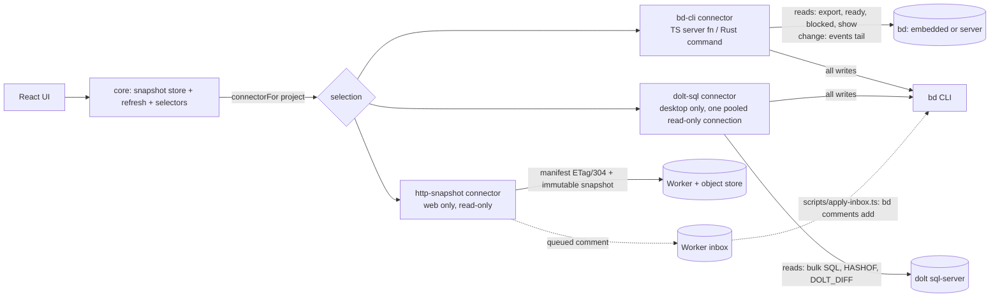

# Read layer: one core, pluggable connectors

Shipped (2026-10-31). Epic `bdb-84h`. Full measurement grid: [reports/read-layer-poc.md](reports/read-layer-poc.md).

## Problem

Switching beads and loading comments is slow, most of all in the desktop app.

Evidence, desktop RUM over two days:

- `bd.call.*` p50 is 1 to 1.4 s and p95 is 4 to 6 s.
- INP on the bead modal is 2.8 to 3.6 s, with 0 long tasks and 0 errors.
- In a window that includes one bead-modal view, RUM records about 11 `projects`, 5 `list` and 3.5 `export` calls, against about 2 `show`.

Evidence from the code before this work (each row was addressed; see [What changed vs the plan](#what-changed-vs-the-plan)):

| Finding                                                                                                                                                                                                                   | Where                                                                                                  |
| ------------------------------------------------------------------------------------------------------------------------------------------------------------------------------------------------------------------------- | ------------------------------------------------------------------------------------------------------ |
| Every Tauri command is a sync `fn`. Tauri runs sync commands on the main thread, so each `bd` spawn (`Command::output()`) freezes the UI, and calls queue behind each other.                                              | `src-tauri/src/desktop.rs` (no `async` in the crate)                                                   |
| The Rust `get_bead_detail` runs `bd show`, then `bd comments`, one after the other. TypeScript runs them in parallel.                                                                                                     | `desktop.rs` `get_bead_detail_inner`, `src/lib/bd.ts` `getBeadDetail`                                  |
| `comment_count` is parsed but never used to skip `bd comments`.                                                                                                                                                           | both backends                                                                                          |
| `KnowledgeDetailModal` is always mounted and observes `['project-knowledge', p]` (a full `bd export`) with no `enabled` flag. Every feed change and every comment therefore re-runs `bd export`, even with no modal open. | `src/components/knowledge-detail-modal.tsx`                                                            |
| The same key has four observers, with staleTime 4 s, 4 s, 30 s and 60 s. The bead modal's copy (4 s) refetches on almost every switch.                                                                                    | `bead-detail-modal.tsx`, `routes/p.$project.tsx`, `project-knowledge-panel.tsx`, `use-palette-data.ts` |
| `['projects']` has three observers on the board page, each with its own 15 s interval. One `projects` call costs 3 to 4 `bd` processes per registered project, run serially.                                              | `project-topbar.tsx`, `project-rail.tsx`, `routes/p.$project.tsx`                                      |
| Every feed change invalidates `beads`, `project-knowledge` and `artifact`, plus one `bead` key per changed issue (300 ms debounce).                                                                                       | `src/hooks/use-bead-feed.ts`                                                                           |

Opening the modal by itself fires only `show`, `comment-author` and possibly `export`. The `projects` and `list` counts come from background polling and the always-mounted export observer, not from the click. A RUM trace that labels the call source is still needed to split the observed counts exactly (see Telemetry).

## Measurements

These are proof-of-concept measurements on a copy of a real tracker: 234 beads, 719 comments, 350 dependencies and 519 labels. The tools were bd 1.3.2 and Dolt 2.5.1 on an Apple-silicon laptop. Times are medians over 7 to 31 runs after a warm-up.

### Embedded `bd` versus a Dolt sql-server

| Operation                          | Embedded `bd`         | `bd` in server mode                                               | Raw SQL, one open connection                                                             |
| ---------------------------------- | --------------------- | ----------------------------------------------------------------- | ---------------------------------------------------------------------------------------- |
| `list --all --json`                | 430 ms                | 89 ms                                                             | issues + comments + deps (3 queries): 6.4 ms; 6.9 ms with labels; readiness not included |
| `ready` / `blocked`                | 239 / 150 ms          | 83 / 86 ms                                                        |                                                                                          |
| `export` (all beads with comments) | 414 ms                | 95 ms                                                             | (same 6.4 ms)                                                                            |
| `show <id>`                        | ~400 ms               | 72 ms                                                             | one bead, 4 queries: 1 ms                                                                |
| `comments <id>`                    | ~205 ms               | 70 ms                                                             |                                                                                          |
| Change probe                       | `bd vc status` 229 ms | 84 ms                                                             | `HASHOF('HEAD')`: 0.1 ms                                                                 |
| Delta since a commit               | none                  | none                                                              | `DOLT_DIFF(from, HEAD, 'issues')`: < 1 ms                                                |
| 1 / 4 / 8 parallel `show`          | 366 / 1981 / 4289 ms  | 74 / 94 / 126 ms (1 / 8 / 32 pooled SQL reads: 1 / 2.9 / 10.9 ms) |                                                                                          |

Facts found along the way:

- **Parallel calls make embedded mode slower.** The embedded engine's process lock serializes concurrent `bd` processes, and the total is worse than running them one at a time (4 parallel: 1981 ms; 4 one after another: about 1460 ms). Today's sync Tauri commands serialize `bd` calls by accident. Making them async without a per-project queue would make embedded mode slower.
- **Server mode alone is 4-5x faster with no bd-board code.** Projects that already run a Dolt server (shared, proxied or server mode) get it today through the existing bd-cli path.
- **Multi-id `show` saves nothing in embedded mode.** `bd show a b c` works, but costs about 270 ms per id there.
- **What each command returns:**
  - `list --json` has labels, `comment_count`, dependency counts and edges, but no comment text.
  - `export` carries comments, labels and dependencies. It also includes rows that `list` hides (for example `gate` beads), and it has no `parent` field. Its dependency edges lack the target's title, status and type, which `show` adds. All three can be fixed from the snapshot: filter like `list`, take `parent` from the parent-child edge, and join edge targets by id.
  - Export size: 924 KB raw, 274 KB gzipped. Gunzip plus parse in Node takes 2.4 ms.
- **`bd` commits every write to Dolt**, in both modes. `HASHOF('HEAD')` moves on each write, so it is a valid change cursor.
- **`bd dolt show --json` takes about 30 ms in embedded mode** and returns `embedded: true` with the data dir. On a project already running a server, it returns `embedded: false`, `host`, `port`, `database`, `user` and `connection_ok`; this was checked on one project. Its output and timeout with the server down were not measured, and one `bd` call in the POC hung for more than 120 s, so the probe needs a hard timeout.
- **`bd serve` was not measured.** It refuses workspaces under temporary directories.

### Remote Dolt server (simulated)

A TCP proxy added a fixed one-way delay. There was no loss, jitter or TLS.

| Operation             | RTT 50 ms | RTT 150 ms |
| --------------------- | --------- | ---------- |
| Bulk read (3 queries) | 167 ms    | 470 ms     |
| One bead (4 queries)  | 212 ms    | 613 ms     |
| 40 beads one by one   | 8.5 s     | 24.5 s     |
| Change probe / delta  | 53 ms     | 153 ms     |

Each statement costs one RTT, and a new connection costs about 3.5 RTT. Over a network, keep one connection open and read in bulk; never read bead by bead.

### Object-store snapshot (R2)

| Operation                                          | Local Worker (miniflare)       | Real R2 + Worker                                  |
| -------------------------------------------------- | ------------------------------ | ------------------------------------------------- |
| Manifest 200 / 304                                 | 3.8 / 3.4 ms (371 B / 0 B)     | 246 / 244 ms                                      |
| Snapshot download + gunzip + parse                 | 4.1 + 1.3 + 1.3 ms (279 KB gz) | 339 + 1.2 + 1.4 ms; full refresh on change 590 ms |
| Inbox POST, list, ack                              | 4.2 / 4.3 / 4.0 ms             | 422 / 373 / 287 ms (cycle 1.09 s)                 |
| Writer upload (snapshot + manifest via the Worker) | 17.6 ms                        | 1.27 s                                            |
| Cold start after deploy / after 7 min idle         | —                              | 1029 / 691 ms (one sample each)                   |

Real-edge numbers were measured from a client about 170 ms RTT from the nearest edge, 30 runs, medians, with synthetic scrambled data of the same size. A 304 saves bytes, not time: it costs the same round trip as a 200. A refresh that changes something costs about 0.6 s, the same order as an embedded `bd export`. So for a machine that runs `bd`, the Worker path is not faster than local reads; it only pays off for viewers without Dolt. The throwaway bucket and Worker were deleted after the run.

Dolt 2.5.1 can also use R2 directly as a remote: `dolt remote --help` lists `s3://bucket/db?endpoint=…&region=auto` for S3-compatible stores with conditional writes, R2 included, with no DynamoDB. Every machine then keeps a full local replica and runs `bd sync` on a timer. The beads [bucket-federation guide](https://beads.gascity.com/multi-agent/bucket-federation) reports about 5 s for a clone, about 1 s for a pull+merge and about 4 s for an incremental push, at about 1.3k issues on GCS (its numbers, not ours). Measured on R2 with the 234-bead database (90 MiB, 1,390 commits), using plain `dolt`:

- Write-to-visible on another replica: 17.5 s.
- Incremental push: 12.3 s. Pull: 5.2 s.
- No-op poll: 2.6 s. Clone: 4.7 s.
- Replica reads: as fast as local.

bd 1.3.2 itself rejects the scheme (`unknown url scheme: 's3'`). A bucket remote is therefore a backup or occasional-sync option, not a live one. For live remote use, a central Dolt sql-server measured 0.2-0.6 s per bulk read at 50-150 ms RTT.

Free tier: one client polling the manifest every 30 s uses 86,400 Class B operations a month (0.9% of 10 M). An inbox that is listed every 30 s uses 86,400 Class A operations (8.6% of 1 M).

## RUM before and after

Source: the desktop service (`bd-board-desktop`) in the `_rumdata` stream. Durations are the SDK's nanoseconds, shown in ms. The new desktop build (snapshot store, bd queue, persisted cache) was installed at 2026-10-31 00:34 UTC (03:34 Africa/Nairobi).

- **Window A (before):** 2026-10-29 00:34 UTC to 2026-10-31 00:34 UTC.
- **Window B (after):** from 2026-10-31 00:34 UTC. **Window B has no data yet.** At query time (00:57 UTC) the last desktop event of any kind was from 2026-10-30 about 19:52 UTC, so the new build has not reported. Web-service events after the cutover are headless test runs against a local dev server and are excluded.

| Metric                                                  | A: p50 / p95, N                                                                                              | B: p50 / p95, N |
| ------------------------------------------------------- | ------------------------------------------------------------------------------------------------------------ | --------------- |
| `bd.call.projects`                                      | 1269 / 1922 ms, N=124                                                                                        | no data (N=0)   |
| `bd.call.list`                                          | 1031 / 3826 ms, N=56                                                                                         | no data (N=0)   |
| `bd.call.export`                                        | 1426 / 4284 ms, N=39                                                                                         | no data (N=0)   |
| `bd.call.show`                                          | 736 / 5976 ms, N=15, too few samples                                                                         | no data (N=0)   |
| `bd.call.comment_author`                                | 1072 / 5252 ms, N=9, too few samples                                                                         | no data (N=0)   |
| `bd.call.status`                                        | 5250 / 6198 ms, N=4, too few samples                                                                         | no data (N=0)   |
| `bd.call.snapshot`, `bd.call.comments`, `bd.call.probe` | not emitted before this build                                                                                | no data (N=0)   |
| INP, bead-modal view                                    | 1568 / 2848 ms, N=21                                                                                         | no data (N=0)   |
| `bd.call` per bead-modal view                           | 7 views: projects 9.7, list 4.6, export 3.0, show 2.0, comment_author 1.1, status 0.3 (N=7, too few samples) | no data (N=0)   |
| Long tasks                                              | 0 (N=0)                                                                                                      | no data (N=0)   |
| Errors                                                  | 0 (N=0)                                                                                                      | no data (N=0)   |

The `view` attribute (bead .1) does not exist in window A, so A is grouped by the RUM view name that was active when the call finished (`view_name`). Reading B by the `view` attribute works once data arrives.

**Target (open or switch a bead under 300 ms at p95): not yet measurable.** There are no post-cutover desktop samples. For reference, the old build's bead-modal INP was p95 2.8 s (N=21), and a warm open on the new build should emit no `bd.call` at all, which is the thing to check first in B.

### Queries

Run per window with the window bounds as the search time range (`start`, `end`); `<service>` is `bd-board-desktop`.

```sql
-- bd.call.* p50/p95/count per label
SELECT replace(vital_name, 'bd.call.', '') AS label, count(*) AS n,
       approx_percentile_cont(vital_duration / 1000000, 0.5) AS p50,
       approx_percentile_cont(vital_duration / 1000000, 0.95) AS p95
FROM "_rumdata" WHERE service = '<service>' AND type = 'vital' AND vital_name LIKE 'bd.call.%'
GROUP BY label ORDER BY label;

-- INP on the bead modal view
SELECT count(*) AS n,
       approx_percentile_cont(view_interaction_to_next_paint / 1000000, 0.5) AS p50,
       approx_percentile_cont(view_interaction_to_next_paint / 1000000, 0.95) AS p95
FROM "_rumdata" WHERE service = '<service>' AND type = 'view' AND view_name = 'bead-modal'
  AND view_interaction_to_next_paint IS NOT NULL;

-- bead-modal views, and the bd.call made inside them (divide for calls per view)
SELECT count(distinct view_id) AS n FROM "_rumdata" WHERE service = '<service>' AND view_name = 'bead-modal';
SELECT replace(vital_name, 'bd.call.', '') AS label, count(*) AS n
FROM "_rumdata" WHERE service = '<service>' AND type = 'vital' AND vital_name LIKE 'bd.call.%'
  AND view_name = 'bead-modal' GROUP BY label ORDER BY label;

-- bd.call by the new `view` attribute (empty before bead .1)
SELECT context_view AS cv, count(*) AS n FROM "_rumdata"
WHERE service = '<service>' AND type = 'vital' AND vital_name LIKE 'bd.call.%' GROUP BY cv ORDER BY n DESC;

-- long tasks, errors
SELECT count(*) AS n FROM "_rumdata" WHERE service = '<service>' AND type = 'long_task';
SELECT count(*) AS n FROM "_rumdata" WHERE service = '<service>' AND type = 'error';
```

### Re-run

Tracked by `bdb-84h.9`. Re-run after at least one day of real use on the new build; until window B has about 20 samples per cell the table says "too few samples". `scripts/o2/rum-before-after.py` runs these queries and prints the table. It reads `O2_URL`, `O2_ORG`, `O2_USER` and `O2_PASS` from the environment, and optionally `CUTOVER_UTC` and `SERVICE`:

```bash
python3 scripts/o2/rum-before-after.py
```

## What other systems do

Only the parts that transfer are listed here.

| Pattern                                                                     | Seen in                                                                                                                                                                                    | Use here                                                                                                                                                                                                                  |
| --------------------------------------------------------------------------- | ------------------------------------------------------------------------------------------------------------------------------------------------------------------------------------------ | ------------------------------------------------------------------------------------------------------------------------------------------------------------------------------------------------------------------------- |
| Opaque cursor, with a full-snapshot fallback when the cursor is unknown     | Replicache cookie and `clear` ([pull](https://doc.replicache.dev/reference/server-pull)); Electric offset/handle and 409 must-refetch ([HTTP API](https://electric.ax/docs/sync/api/http)) | The cursor is the feed `seq` (bd-cli) or the Dolt head hash (SQL). An unknown or rewritten cursor means "take a full snapshot".                                                                                           |
| Poke, then a single-flight pull                                             | Replicache poke ([how it works](https://doc.replicache.dev/concepts/how-it-works))                                                                                                         | The feed or a probe only says "changed". One refresh per project runs at a time.                                                                                                                                          |
| Immutable snapshot plus a tiny manifest, with ETag/304 on the manifest only | Electric's cacheable initial shape; Litestream snapshots plus LTX ([how it works](https://litestream.io/how-it-works/))                                                                    | `snap-<commit>.jsonl.gz` plus `manifest.json`. R2 `get(…, {onlyIf})` returns no body on a match, and the Worker maps that to 304 ([R2 Workers API](https://developers.cloudflare.com/r2/api/workers/workers-api-usage/)). |
| Single-writer lease through a conditional put                               | Litestream ([revamped](https://fly.io/blog/litestream-revamped/)); R2 `put` with `onlyIf`                                                                                                  | Only needed if a Worker inbox is ever built.                                                                                                                                                                              |
| Optimistic write held until the confirmed feed passes it                    | Linear sync ([reverse-engineered](https://github.com/wzhudev/reverse-linear-sync-engine))                                                                                                  | Later, and only if write latency matters. Writes stay on `bd`.                                                                                                                                                            |
| Persisted query cache with a `buster`                                       | TanStack Query [persistQueryClient](https://tanstack.com/query/latest/docs/framework/react/plugins/persistQueryClient)                                                                     | Instant cold start with no new dependency. TanStack DB is 0.x, so not now.                                                                                                                                                |
| A replica chosen by URL                                                     | Turso embedded replicas ([intro](https://docs.turso.tech/features/embedded-replicas/introduction))                                                                                         | A project's source URL scheme picks its connector.                                                                                                                                                                        |

Tauri facts the design relies on ([calling Rust](https://v2.tauri.app/develop/calling-rust/)):

- Non-`async` commands run on the main thread, and `async` commands run on the async runtime.
- `Channel` is the streaming path; events are for small payloads.

## Architecture



### The core: one place, in the client

The snapshot cache lives in the client's query cache (the browser or WebView side), not in each backend. The backends add only a `snapshot` call and a per-project `bd` queue.

1. **`snapshot(project)` returns `{ beads, ready, blocked, cursor }`.** Beads carry their comments, labels and edges.
   - **bd-cli:** `export`, then `ready`, then `blocked`, one after another, because parallel calls are slower on the embedded lock. That is about 800 ms embedded and about 270 ms in server mode.
   - **dolt-sql:** one bulk SQL read for beads; ready and blocked still come from `bd`.
   - The `cursor` is a hash of the `bd` outputs (the feed sequence would cost another call).
2. **One `bd` queue per project, in both backends** (`src/lib/bd-queue.ts`, `adapters/bd_cli/queue.rs`).
   - **Concurrency:** 1 call at a time, 4 once the probe shows a reachable Dolt server. Writes pass a limit-1 FIFO in front, so they land in arrival order.
   - **Single-flight:** identical reads share one process. A caller never receives a read that began before its call, because a write may have landed in between.
   - **Lanes:** two FIFO lanes, user calls before background polls and the probe. Nothing is preempted.
   - **Timeouts:** every spawn has a 60 s timeout (`BD_BOARD_BD_TIMEOUT_MS`). On expiry the child's process group gets SIGTERM, then SIGKILL after 2 s. On quit, running children are not killed: a write runs to completion.
3. **The refresh is driven by the feed.**
   - **Feed live:** writes patch the cache optimistically and do not refetch. The feed's `change` message carries the journal `ops` behind it. A comment-only change fetches `bd comments <id>` and patches that bead; any other or unknown op runs a full snapshot.
   - **Pacing:** single-flight (one running plus one trailing), debounced 300 ms, and the next refresh starts no sooner than the last one took. That keeps the lock under 50% busy during agent bursts.
   - **TanStack Query:** a feed-driven refresh uses `cancelRefetch: true`, because a fetch already in flight may predate the change and joining it would mark stale data fresh. `cancelQueries` runs before optimistic patches, and `settleWrite` re-runs a cancelled refresh. Refreshes of a loaded snapshot and comment patches use the `background` lane; the first load is a user call.
   - **Feed not live** (disabled, error, unsupported): the old fallback poll. http-snapshot has no feed; it polls the manifest.
4. **Selectors** are pure functions over the snapshot: the board list (filtered like `list`, so export-only types such as `gate` stay hidden), bead detail (`parent` from the parent-child edge, edge targets joined by id), knowledge entries and `:::question` state. **Opening a bead costs no `bd` call**; parity with `show` is pinned by a test.
5. **Persistence.** Snapshot queries (only those) are saved to IndexedDB, so a cold start paints the last board before any `bd` call returns. The restored data is stale and the normal background refresh revalidates it. At most 8 projects (LRU), 24 h max age, `buster` = the core schema version.
6. **Writes** go through `connectorFor(project)`. Every local connector writes through the `bd` CLI, because bd owns the schema, its hooks and the auto-commit. There are no SQL writes.

The palette's cross-project comment index keeps its own 60 s staleTime, because the feed only covers the open project.

**Desktop layout.** `src-tauri/src` is split into `domain` (no outside imports), `ports` (`BeadSource` for reads, `BeadSink` for writes), `adapters` (`bd_cli`, `dolt_sql`), `app` and `commands`. Dependencies point one way (commands → app → ports ← adapters); `tests/architecture.rs` enforces it. Tauri commands are `async` and run `bd` on the blocking pool, so the UI thread no longer waits on a spawn. `just ci` (frontend gate plus format, clippy and `cargo test`) is the gate.

### Connectors

| Connector       | Ingress (reads, change signal)                                                                                                                     | Egress (writes)                                                                                                                 | Where                                               | Safety                                                                                                                                                                                                                                                                    |
| --------------- | -------------------------------------------------------------------------------------------------------------------------------------------------- | ------------------------------------------------------------------------------------------------------------------------------- | --------------------------------------------------- | ------------------------------------------------------------------------------------------------------------------------------------------------------------------------------------------------------------------------------------------------------------------------- |
| `bd-cli`        | `export`, then `ready`, then `blocked`; `bd events tail --follow` (the feed)                                                                       | `bd` CLI                                                                                                                        | Web (TS server fn) and desktop (Rust command)       | Default, zero config, any project. Per-project queue, timeouts and lanes (above).                                                                                                                                                                                         |
| `dolt-sql`      | one bulk read on one pooled connection per project; `HASHOF('HEAD')` probe every second; `DOLT_DIFF` names the beads of a comment-only change      | `bd` CLI (SQL is read-only)                                                                                                     | Desktop only (Cargo feature `dolt-sql`, default on) | Read-only. `credentials_ref` names only `DOLT_REMOTE_USER`/`DOLT_REMOTE_PASSWORD` or `BD_BOARD_DOLT_*` variables. A non-loopback host needs TLS (`tls=true`), checked before any credential is read. No user or password in the URL.                                      |
| `http-snapshot` | `manifest.json` with If-None-Match → 304, then an immutable `snap-<sha256 prefix>.jsonl.gz` verified against the manifest sha256; polls every 30 s | None. Comments can be queued on the Worker inbox (`POST /inbox`) and applied on the owner's machine by `scripts/apply-inbox.ts` | Web only (the token stays server-side)              | Read-only; every write is refused. Token from `credentials_ref`, a plain `BD_BOARD_SNAPSHOT_*` name. `https` only (plain `http` for localhost); redirects are errors, so the token never follows one. The inbox token can only queue; the UI does not call the inbox yet. |

**dolt-sql details.** Its win is smaller than the headline numbers: server-mode `bd` already refreshes in about 270 ms and a warm bead open costs no call. What it adds is a near-free change probe and remote servers, where each `bd` process pays several RTTs. Against a temp local server, the SQL read takes about 1.4 ms (median) and a change shows in about 1.05 s with a 1 s poll, against about 225 ms for `bd export` + `ready` + `blocked`.

- **Reads.** The tables `issues`, `dependencies`, `labels` and `comments`, plus `schema_migrations`, in one multi-statement round trip inside a read-only transaction (about one RTT per refresh on a remote hub). It returns every row, closed beads and gates too, like `bd export`; wisps are not read.
- **Same output as bd-cli.** Rows become `bd export` lines and go through the same `build_snapshot`. `src-tauri/tests/dolt_sql.rs` starts a temp `dolt sql-server` over a bd 1.3.2 fixture and compares bead lists field for field.
- **Readiness.** Local server-mode projects keep `ready` and `blocked` on `bd`. A project with no local bd (an explicit `mysql://` source without `bd:`) gets them empty and `readiness_unavailable: true`, which the UI shows. The `ready_issues` and `blocked_issues` views disagree with `bd ready` / `bd blocked` on 1.3.2, so the reader does not use them.
- **Schema drift.** On connect it requires `MAX(version)` of `schema_migrations` to be one it was checked against (66, bd 1.3.2), and otherwise fails with `source misconfigured (dolt-sql)`. That is deliberately not a fallback trigger, so a bd upgrade is noticed. Widen `SUPPORTED_SCHEMA_VERSIONS` only after re-running the parity test.
- **Read-only.** The session is `READ ONLY`, but in Dolt 2.5.1 that blocks INSERT, UPDATE and DELETE and **not** DDL or `CALL`. The real guards: the adapter only builds `SELECT` text (a unit test pins every statement), and the login should be a SELECT-only database user ([remote-projects.md](remote-projects.md#reading-a-hub-over-sql-dolt-sql)). A project that lists only `mysql://` sources is read-only in the UI and in every write command.
- **Credentials.** Where the login comes from depends on where the target came from. An explicit `mysql://` source uses `credentials_ref`, else the `[host:port]` entry of the beads credentials file, else no password. Only the server `bd dolt show` reported is resolved the way bd does (`BEADS_DOLT_*`). Any other variable name is refused at registry load and again at resolve time, so a registry entry cannot aim an arbitrary secret at an arbitrary host. A keychain reference is not implemented.
- **Failure.** Connect, read and write timeouts are 2 s. `source unavailable (dolt-sql): …` (refused, timed out, TLS handshake, not in server mode) is connection-class and falls to the next source. `source misconfigured (dolt-sql): …` (bad login, unknown schema, remote without TLS) is shown, not skipped. Neither contains a host, user, password or URL. With no source left the board keeps the last snapshot and says "Hub unreachable, showing last snapshot (age)".
- **Driver.** The sync `mysql` crate with rustls adds about 4.2 MB to the release binary (12.0 to 16.2 MB), so it sits behind the `dolt-sql` feature.

**http-snapshot and the Worker.** The Worker and the writer ([README](../workers/snapshot/README.md)) are built and tested locally and **not deployed**. The Worker has separate read, write and inbox tokens and fails closed when one is unset. The inbox (`comment.add` only, validated, deduplicated by `client_id`, applied exactly once with an `(inbox)` author suffix) exists as a Worker queue, an applier script and `queueComment` in `src/lib/connectors/inbox.ts`. No UI calls it, so the bead modal's comment box is still read-only on http-snapshot projects.

**Remote Dolt over a bucket** (R2, S3, GCS) is not a connector ([remote-projects.md](remote-projects.md)). It is a project setup step: the machine keeps a local replica (`bd init --remote …`, then `bd sync` on a timer) that bd-cli or dolt-sql reads like any local project. Costs: bucket credentials on every machine; `bd sync` exits 2 when two replicas edit the same bead between syncs; schema upgrades must be migrated on one designated machine only; something other than bd-board runs the sync timer. It does not serve a phone or a web viewer.

**Migration** stays manual. bd-board only detects the mode. For embedded projects it offers a "Copy prompt" with the migration steps, the measured speed-up and three options: a local shared-server, a bucket remote and a remote deployed server ([procedure](remote-projects.md#a-make-a-project-faster-embedded-to-shared-server)). The docs recommend shared-server (one bd-managed server for all projects), which is not experimental in bd 1.3.2. bd-board's own tracker runs that way, with a Dolt remote on object storage.

### Automatic selection

`connectorFor(project)` is synchronous and returns a per-project router. On its first call the router builds an ordered candidate list, probes once per session, and uses the first candidate whose kind has a registered factory (`registerConnectorKind`). bd-cli is registered everywhere, http-snapshot in the web build only and dolt-sql in the desktop build only; the router skips a kind that is not registered.

1. **Explicit `sources`.** An optional ordered list on the registry entry, tried first to last: `bd:` → bd-cli, `mysql://host:port/db` → dolt-sql, `https://…` → http-snapshot. Any other scheme fails registry load. bd is not probed.
2. **Default order** (no `sources`): local embedded bd, then a Dolt sql-server, then bd-cli. The probe is `bd dolt show --json` with a 2 s timeout. `embedded: true` → [bd-cli]; `embedded: false` with `connection_ok` → [dolt-sql at the reported host, port and database, bd-cli]; a probe error or timeout → [bd-cli].
3. **Live fallback.** A connection-class error (refused, reset, unreachable; not "not found" or validation) marks that candidate unhealthy for the session, emits one `connector.fallback` RUM action (kinds only), retries on the next candidate and stays there. **Writes are never retried** (they may have committed): the candidate is marked and the error rethrown. A failed probe is retried once after 30 s. With no candidate left the original error is rethrown. The live feed picks a connector but does not fail over.

The probe reply carries the entry's `sources`, so the client needs no extra read. On desktop the Rust side, not the webview, decides which server dolt-sql talks to (the first `mysql://` entry of `sources`, else the server `bd dolt show` reports). bd-board never starts, stops or supervises a Dolt server and never migrates a project between modes.

## What changed vs the plan

| Plan step                                                             | Shipped as                                                                                                                                                                             | PR            |
| --------------------------------------------------------------------- | -------------------------------------------------------------------------------------------------------------------------------------------------------------------------------------- | ------------- |
| `cargo test` in CI (new, first)                                       | `cargo test` in CI, then `just ci` as the single gate                                                                                                                                  | #24, #31      |
| 1. Async Rust commands, show+comments in parallel, skip comments at 0 | `async` commands plus `spawn_blocking` behind a per-project queue (serialized, not parallel, because of the embedded lock); spawn timeouts; later lanes, serialized writes and signals | #20, #26      |
| 2. Modal stops refetching `project-knowledge`                         | Query hygiene, widened: the always-mounted knowledge observer is gated and the three `['projects']` observers share one options object                                                 | #18           |
| Caller label on `bd.call` (new)                                       | `view` attribute on every `bd.call.*` vital                                                                                                                                            | #19           |
| The seam (new)                                                        | `Connector` interface with bd-cli as the only connector                                                                                                                                | #13           |
| 3. Per-project snapshot, built in both backends                       | One client-side snapshot store and feed-driven refresh; bead open with zero `bd` calls on a warm cache                                                                                 | #27           |
| 4. Persist the React Query cache                                      | Snapshot queries only, in IndexedDB, with a `buster`                                                                                                                                   | #28           |
| Probe and auto-selection (new)                                        | Ordered `sources`, probe, live read fallback, writes never retried                                                                                                                     | #22           |
| dolt-sql connector (new)                                              | Built: read-only, desktop only, parity-tested against `bd export`                                                                                                                      | #33           |
| 5. R2 snapshot + Worker + inbox (narrowed)                            | Built but **not deployed**: writer and token-gated Worker; read-only `http-snapshot` connector; write-back inbox (Worker queue and applier, no UI)                                     | #23, #30, #29 |
| Remote setup docs, migration                                          | [remote-projects.md](remote-projects.md); migration copy-prompt                                                                                                                        | #21, #25      |
| Not in the plan                                                       | `desktop.rs` split into domain, ports, adapters, app and commands, with an architecture test                                                                                           | #24           |

## Risks

- **Lock contention with agents.** Every bd-board refresh holds the embedded lock and slows the agents' own `bd` writes. The queue, the minimum gap between refreshes and op-based patches are meant to keep it under 50% busy. Not yet measured during a real agent burst.
- **Migration.** Moving a project from embedded to server mode has no `bd` command in 1.3.2. It stays a manual, owner-approved, per-project step; bd-board only detects the mode.
- **Snapshot size.** Export grows with comments. At 274 KB gzipped (0.9 MB raw) for 234 beads it is fine. Above a few thousand beads, refresh by delta (`DOLT_DIFF`, or feed ids followed by `show`).
- **Stale reads.** A snapshot can lag a write by one refresh, and a persisted snapshot is stale until the first refresh returns. Writes patch the cache optimistically until the feed confirms.
- **bd upgrades.** dolt-sql refuses an unchecked schema version, and the parity test must be re-run on each new bd. Field parity of snapshot-derived detail against `show` is pinned by a test on a generic fixture.
- **Bucket remotes are multi-writer.** Two replicas that edit the same bead between syncs conflict, and a human resolves it.
- **Worker surface.** A deployed Worker is internet-reachable and needs three tokens to manage (read, write, inbox). The inbox has a queue bound of 500 but no per-token rate limit; add a Cloudflare rule if it is deployed.
- **Remote dolt-sql.** A hub login that is not SELECT-only can run DDL or `CALL` on the session, because Dolt's read-only mode does not block them.

## Decisions

- **Migration (owner, 2026-10-30).** bd-board only detects server mode, uses dolt-sql where a server already exists, and never migrates a project.
- **Recommended mode (owner, 2026-10-30).** The docs and the prompt recommend shared-server.

## Open items

Follow-ups are tracked in bead `bdb-84h.20`; the RUM re-run in `bdb-84h.9`.

- **Is a no-Dolt viewer (web or phone) in scope?** If not, http-snapshot, the Worker, the writer and the inbox can be dropped. Deploying the Worker is the owner's call.
- **Inbox UI.** Whether the bead modal's comment box should queue through the inbox on http-snapshot projects.
- **RUM re-run** (`bdb-84h.9`): window B is empty. Check first that a warm bead open emits no `bd.call`.

## Not verified

- **The 300 ms p95 target.** There are no desktop samples from the new build yet.
- **Why the old build called what it did.** The RUM call counts were inferred from code; the `view` label now makes this checkable.
- **Real-network behaviour.** Remote numbers are simulated (no jitter or loss), and no remote SQL write-to-visible time was measured.
- **Safety of `HASHOF('HEAD')` and `DOLT_DIFF`** on a connection that `bd` also writes through, and whether uncommitted `WORKING` rows ever appear (bd auto-commits, so none are expected).
- **`bd serve`.** Not measured; it refuses workspaces under temporary directories.
- **Main-thread time saved by async commands.** Expected from the Tauri docs, not profiled.
- **Lock contention in a real agent burst.**
- **The deployed Worker and the writer** against real R2 in steady use: the edge numbers above are from a POC, not from the shipped Worker.
